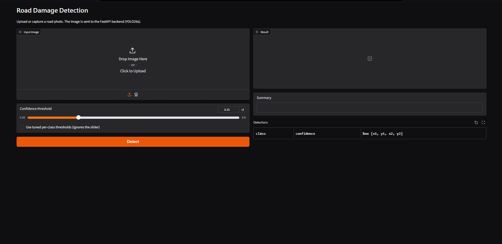
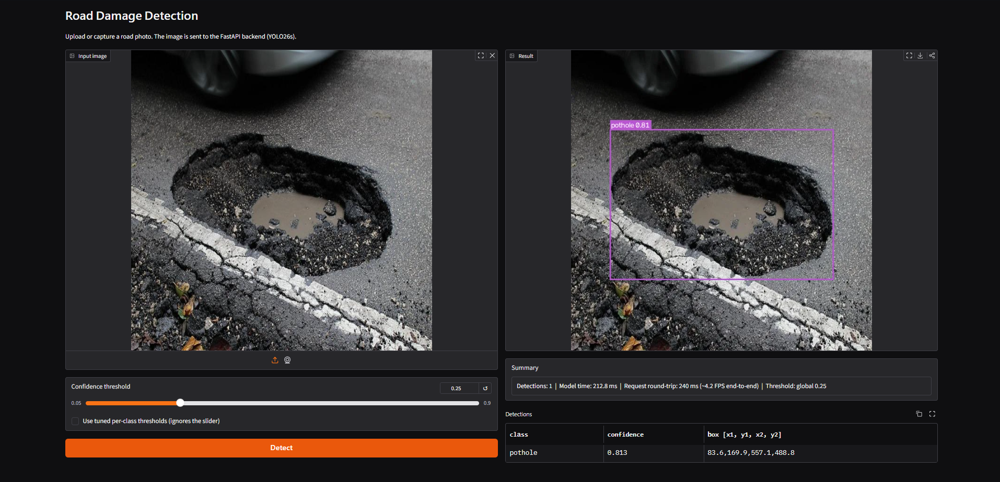
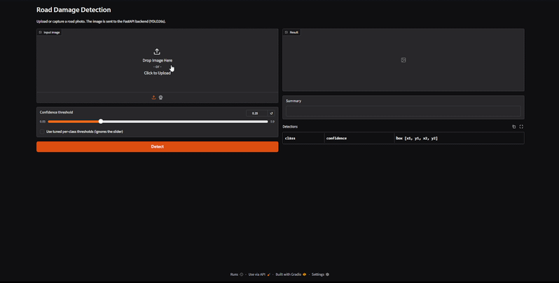

# Road Damage Detection with YOLO

End-to-end computer-vision project: dataset audit and cleaning, training and comparison of three YOLO generations, evaluation on a held-out test set, and a deployed detector served through **FastAPI** with a **Gradio** front end.

## Application Demo

**Application Interface**



**Detection Result**



**Live Demo**



## Summary

| | |
|---|---|
| **Task** | Detect and localize 6 road-damage types in images |
| **Models compared** | YOLOv8s, YOLO11s, YOLO26s (identical training settings) |
| **Selected model** | **YOLO26s**: test mAP50 **0.564**, mAP50-95 **0.338** |
| **Serving** | FastAPI backend (ONNX, CPU) + Gradio UI |
| **Speed** | about 10 to 12 ms/image on a T4 GPU; about 150 ms/image on CPU with ONNX (about 6 FPS) |

**Main findings**
1. The original dataset split **leaked** augmented copies of the same source images across train/valid/test. I rebuilt the splits (stratified group split) before any training.
2. YOLO26s ranks first on both validation and test. YOLOv8s and YOLO11s are **not distinguishable** from a single run each.
3. The hard part is separating damage from background, not telling damage classes apart. `alligator` and `longitudinal` are the weakest classes for every model.
4. Two tuning experiments on the best model (`imgsz=800`, `epochs=50`) did **not** pass the acceptance rule, so the baseline configuration was kept.

## Repository structure

```
road-damage-detection/
├── notebooks/
│   ├── 01_dataset_preparation.ipynb   # EDA, label audit, leakage check, re-split
│   ├── 02_training.ipynb              # baselines + tuning experiments
│   └── 03_evaluation.ipynb            # test-set comparison, speed, ONNX, thresholds
├── app/
│   ├── main.py                        # FastAPI routes
│   └── detector.py                    # model loading, inference, drawing
├── frontend/
│   └── gradio_app.py                  # Gradio UI (calls the API)
├── results/                           # Validation figures
├── docs/
│   ├── app_UI.png
│   ├── app_demo.png
│   └── app_demo.gif                    
├── models/                          
│   └── class_thresholds.json
├── requirements.txt
└── README.md
```

## Notebooks
| Notebook | Purpose | Kaggle |
|---|---|---|
| `01_dataset_preparation` | EDA, label audit, leakage check, re-split | [link](https://www.kaggle.com/code/osmanahmedosman/road-damage-detection-data-preparation-cleaning) |
| `02_training` | Baselines and tuning experiments | [link](https://www.kaggle.com/code/osmanahmedosman/road-damage-detection-yolo-benchmarking) |
| `03_evaluation` | Test-set comparison, speed, ONNX, thresholds | [link](https://www.kaggle.com/code/osmanahmedosman/road-damage-evaluation) |

Notebooks 02 and 03 read a cleaned dataset produced by notebook 01. To reproduce:
run 01 with your own Roboflow API key (set `WORKSPACE`, `PROJECT`, `VERSION`
to your copy of the dataset), then point `INPUT_DIR` in 02 and 03 to its output.

## 1. Dataset

Source: the [Road Damage dataset on Roboflow Universe](https://universe.roboflow.com/trafficsignssafeway/road-damage-l1ju7).

| | Original | After cleaning |
|---|---|---|
| Images | 6,757 (4,930 / 1,146 / 681) | 6,756 (4,851 / 1,238 / 667) |
| Classes | 7 | 6 |
| Boxes | 20,616 | 20,594 (14,844 / 3,722 / 2,028) |

**Class counts (all splits):** pothole 8,583 · alligator 5,914 · longitudinal 2,867 · crack 2,115 · transverse 677 · block 438. Potholes and alligator cracks make up about 70% of all boxes.

### Audit and decisions

| Finding | Evidence | Action |
|---|---|---|
| **Split leakage** | 300 source-image names appeared in more than one split (123 involving the test set). No file was byte-identical across splits, but visual inspection of a random sample of 6 sources showed the same scenes under augmentation in 3 of them | Re-split with `StratifiedGroupKFold`, grouping by source image; 0 sources now span two splits, 0 byte-identical files across splits |
| **Unevaluable class** | `edge` had 22 boxes (15 train, 7 valid, 0 test) | Removed (plus 1 image containing only `edge`); listed as future work |
| **Small objects** | 31% of boxes cover less than 1% of the image (pothole 51%, longitudinal 38%) | Tested a larger input size (see Tuning) |
| **Polygon labels** | 85 polygon lines (0.41% of boxes) in 35 files | Handled by converting to bounding boxes in my own evaluation code |
| **Near-zero boxes** | 50 boxes below 0.01% of image area (0.24%) | Kept; negligible impact |

Note: the small-object statistics were computed before I noticed the polygon lines, so they may be off by at most about 0.4 percentage points.

## 2. Method

- **Framework:** Ultralytics 8.4.191, PyTorch 2.11, NVIDIA T4 (Kaggle).
- **Models:** YOLOv8s, YOLO11s, YOLO26s, all COCO-pretrained, same size class (`s`).
- **Identical settings:** image size 640, 30 epochs, early-stopping patience 10, batch 16, AdamW with `lr0=0.001`, seed 42. The optimizer is fixed explicitly so that no model silently picks a different one.
- **Protocol:** the validation set guides training and model selection; the **test set was used once**, for the three baselines only. Tuning experiments were decided on validation and are not re-evaluated on test.

## 3. Results

### Test-set accuracy (three baselines, evaluated once)

| Model | mAP50 | mAP50-95 | Precision | Recall | F1 |
|---|---|---|---|---|---|
| YOLOv8s | 0.528 | 0.315 | 0.628 | 0.488 | 0.549 |
| YOLO11s | 0.524 | 0.306 | 0.575 | 0.510 | 0.540 |
| **YOLO26s** | **0.564** | **0.338** | **0.651** | **0.518** | **0.577** |

Precision, recall and F1 are reported at each model's own best-F1 threshold, so mAP is the fairer comparison.


### Per-class mAP50-95 (test)

| Class | YOLOv8s | YOLO11s | YOLO26s |
|---|---|---|---|
| alligator | 0.156 | 0.146 | 0.161 |
| block | 0.654 | 0.615 | 0.646 |
| crack | 0.306 | 0.321 | 0.368 |
| longitudinal | 0.114 | 0.102 | 0.141 |
| pothole | 0.329 | 0.332 | 0.340 |
| transverse | 0.328 | 0.318 | 0.370 |


`block` has only 46 test instances and `transverse` 58, so their scores are noisy.

### Matches at confidence 0.25 (IoU ≥ 0.5, 2,028 ground-truth boxes)

| Model | TP | FP | FN | Precision | Recall | Mean IoU of TPs |
|---|---|---|---|---|---|---|
| YOLOv8s | 831 | 494 | 1,197 | 0.627 | 0.410 | 0.770 |
| YOLO11s | 776 | 412 | 1,252 | 0.653 | 0.383 | 0.778 |
| YOLO26s | 823 | 405 | 1,205 | 0.670 | 0.406 | 0.779 |

- YOLO26s finds about as many objects as YOLOv8s (823 vs 831); its advantage comes from **fewer false positives** and better confidence ranking.
- Box quality (IoU) is equal across models. This metric only covers detections with IoU ≥ 0.5, so it cannot fall below 0.5 by construction.
- At the default threshold about 60% of ground-truth damage is missed, which motivates the per-class thresholds below.


### Efficiency

Speed was measured on a shared cloud machine (T4 GPU and its CPU), one run per model: use it for relative comparison only.

| Model | Params (fused) | GFLOPs | .pt | ONNX | GPU ms | CPU ms (PyTorch) | CPU ms (ONNX) |
|---|---|---|---|---|---|---|---|
| YOLOv8s | 11.13M | 28.4 | 22.5 MB | 44.8 MB | 10.1 | 207.7 | 180.3 |
| YOLO11s | 9.42M | 21.4 | 19.2 MB | 37.9 MB | 10.0 | 171.9 | 149.2 |
| YOLO26s | 9.47M | 20.8 | 20.3 MB | 38.2 MB | 11.9 | 177.6 | 150.4 |


ONNX is about 13 to 15% faster than PyTorch on CPU, but its file is roughly twice the `.pt` size. On my own machine the deployed ONNX model ran at about 174 to 184 ms per image (about 6 FPS).

### Error analysis (YOLO26s, test set)


This matrix was computed at a near-zero confidence threshold, so it shows what the model *can* find, not deployment behaviour.

- Confusion **between damage classes is small**: the largest off-diagonal cell is 17 of 2,025 instances.
- The main failure mode is **separating damage from background**. At this threshold `alligator` accounts for 38% of background false positives, followed by `pothole` (23.5%) and `longitudinal` (19.4%); the same pattern appears on the validation set.
- `alligator` is detected with low confidence and ambiguous box extents in the sample images I inspected (a small sample, so this is a hypothesis about label ambiguity, not a finding).

## 4. Hyperparameter tuning

Only the best model (YOLO26s) was tuned, because of GPU-time limits. Each experiment changes one factor against the baseline (mAP50-95 = 0.328 on validation). The acceptance rule was fixed before running: **at least +0.01 mAP50-95**.

| Experiment | Change | mAP50 | mAP50-95 | Train time | Decision |
|---|---|---|---|---|---|
| Baseline | 640 px, 30 epochs | 0.548 | 0.328 | 41.8 min | reference |
| E1 | `imgsz=800` | 0.539 | 0.320 | 65.2 min | rejected |
| E2 | `epochs=50` | 0.548 | 0.332 | 69.9 min | rejected (+0.004) |

- The source images are natively 640×640, so upscaling to 800 adds no new detail.
- With 50 epochs the metric plateaued around 0.33 without early stopping; there is no evidence of under-training.
- Not explored: learning rate, augmentation settings, and tuning of the other two models.

## 5. Deployment

**Architecture:** the Gradio UI sends images to the FastAPI service, which runs the YOLO26s ONNX model on CPU.

| Endpoint | Description |
|---|---|
| `GET /health` | Service status, model name, class list |
| `POST /predict` | Image in, JSON out (class, confidence, box, inference time) |
| `POST /predict/annotated` | Image in, PNG with boxes out (optional FPS overlay) |

Query parameters: `conf` (0.01 to 0.99), `per_class` (use tuned per-class thresholds), `show_fps` (annotated endpoint).

**Per-class thresholds** were chosen from the **validation** set (maximum smoothed F1 per class), so the test set stayed untouched:

| alligator | block | crack | longitudinal | pothole | transverse |
|---|---|---|---|---|---|
| 0.111 | 0.332 | 0.208 | 0.185 | 0.291 | 0.339 |

**Input validation:** file type (415), size limit (413), and real image decoding (400); invalid parameters return 422.

**Error Handling**

The API validates uploaded files and request parameters before running inference. It returns appropriate HTTP status codes with descriptive error messages:

| Status Code | Error | Condition |
|---|---|---|
| `400 Bad Request` | Invalid image | The uploaded file cannot be decoded as a valid image. |
| `413 Payload Too Large` | File too large | The uploaded file exceeds the configured 10 MB limit. |
| `415 Unsupported Media Type` | Unsupported file type | The uploaded file's MIME type is not JPEG, PNG, or WebP. |
| `422 Unprocessable Entity` | Invalid parameters | Request parameters fail validation, such as a confidence threshold outside the allowed range (0.01–0.99). |

These checks prevent invalid inputs from reaching the detection model and provide clear feedback to API clients.

### Run locally

```bash
python -m venv .venv
.venv\Scripts\activate            
python -m pip install -r requirements.txt
```

Place `yolo26s.onnx` and `class_thresholds.json` in `models/` (see Model weights), then in two terminals:

```bash
# Terminal 1: API
uvicorn app.main:app --reload
# interactive docs: http://127.0.0.1:8000/docs

# Terminal 2: UI
python frontend/gradio_app.py
```

Configuration through environment variables: `MODEL_PATH`, `THRESHOLDS_PATH`, `MAX_UPLOAD_MB`, `API_URL` (for the UI).

Example request:

```bash
curl -X POST "http://127.0.0.1:8000/predict?per_class=true" -F "file=@samples/test.jpg"
```

## 6. Limitations

- **One training run per model:** no variance estimate, so small gaps (for example YOLOv8s vs YOLO11s) are not meaningful. Differences of about 0.03 mAP may be real, but this was not tested statistically.
- **Small per-class test sets:** `block` (46 instances) and `transverse` (58) have unstable metrics.
- **Group split relies on filenames:** scenes duplicated under different names could still overlap; the byte-level hash check only catches exact copies.
- **Test data count:** the training framework evaluated 666 of the 667 test images (cause not investigated).
- **Weak classes:** `alligator` and `longitudinal` (best mAP50-95 0.16 and 0.14) should be presented to users as "possible", not "confirmed".
- **Real-time:** about 6 FPS on CPU is not smooth video; frame skipping or a GPU is needed for live streams.
- **ONNX parity** with the PyTorch weights was only checked qualitatively on a few images, not on the full test set.
- **Tuning scope:** only the best model, two one-factor experiments.
- **Speed numbers** come from a shared cloud machine and vary between runs; the dataset license was not reviewed in detail.

## 7. Future work

- Collect more `edge` samples and re-introduce the class.
- Review `alligator` labels for consistency and re-annotate if needed.
- Repeat training with several seeds and report variance; tune the other models.
- Add Docker packaging and live-video streaming with frame skipping.
- Evaluate ONNX/PyTorch parity on the whole test set.

## Reproducibility

Training and evaluation ran on Kaggle (Tesla T4) with Ultralytics 8.4.191 and PyTorch 2.11. Seeds are fixed (42) for training and for the data split.

## Acknowledgments

Dataset: Roboflow Universe "Road Damage". Models: Ultralytics YOLO.


**Osman Ahmed Osman**
AI & Data Solutions Engineer

- [GitHub](https://github.com/osmanahmedosman)
- [LinkedIn](https://www.linkedin.com/in/osmanahmedosman/)
- [Kaggle](https://www.kaggle.com/osmanahmedosman)
